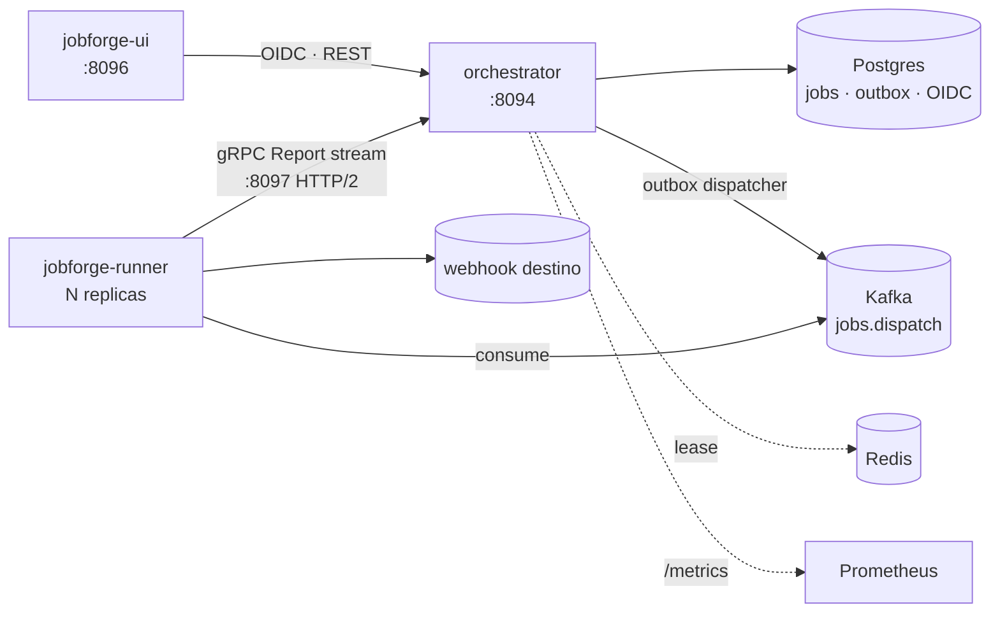

# jobforge-orchestrator

[](https://github.com/TiagoR85/jobforge-orchestrator/actions/workflows/ci.yml)
[](https://github.com/TiagoR85/jobforge-orchestrator/releases)
[](LICENSE)

Orchestrator of the jobforge family: a REST API for scheduling HTTP jobs (idempotency keys, cron or one-shot), an OpenIddict client-credentials issuer, a transactional outbox publishing to Kafka, a cron scheduler with a Redis lease, and a gRPC stream through which the (separate) runner reports execution status.



## Status

First of the three jobforge repositories (spec: orchestrator, runner, UI). This repo is complete through the orchestrator scope; `jobforge-runner` and `jobforge-ui` follow in the next plans of the family.

## Quickstart (≤5 min)

```powershell
Copy-Item .env.example .env   # fill POSTGRES_PASSWORD and OIDC_CLIENT_SECRET
docker compose up --build -d
curl http://localhost:8094/health/live   # 200
```

Get a token and create a job (one-shot example):

```powershell
$body = "grant_type=client_credentials&client_id=jobforge-demo&client_secret=<secret>&scope=jobs:read%20jobs:write"
$token = (Invoke-RestMethod http://localhost:8094/connect/token -Method Post -ContentType "application/x-www-form-urlencoded" -Body $body).access_token
# POST /v1/jobs with headers: Authorization: Bearer $token, Idempotency-Key: <guid>
```

The created execution lands in the outbox and is published to Kafka topic `jobs.dispatch` within ~500ms (verify with `kafka-console-consumer` inside the compose).

## Running tests

Tests use Testcontainers (Postgres, Redis, Kafka) — Docker must be running.

```powershell
dotnet test tests/JobForge.Orchestrator.Tests -p:CollectCoverage=false   # fast loop
dotnet test tests/JobForge.Orchestrator.Tests                            # CI gate (coverage ≥80%)
```

## API

All endpoints require a bearer token (client-credentials from `POST /connect/token`; clients `jobforge-demo` / `jobforge-console`).

| Endpoint | Scope | Notes |
|---|---|---|
| `POST /v1/jobs` | `jobs:write` | `Idempotency-Key` header required; `cron` null → immediate execution |
| `POST /v1/jobs/{id}/run` | `jobs:write` | run now |
| `GET /v1/jobs` · `GET /v1/jobs/{id}` | `jobs:read` | definitions + latest state |
| `GET /v1/executions?status=&page=&size=` · `GET /v1/executions/{id}` | `jobs:read` | history |
| `DELETE /v1/jobs/{id}` | `jobs:write` | soft-disable |
| `/health/live` · `/health/ready` | public | ready = Postgres + Redis + Kafka |
| `/metrics` | public | Prometheus |

The runner contract is `Protos/jobforge/v1/status.proto` (`ExecutionStatus/Report`, bidirectional stream) served on the dedicated HTTP/2 port **:8097**.

## Decisions

- [ADR-0001](docs/adr/ADR-0001-in-process-outbox.md) — transactional outbox, in-process dispatcher; no CDC, no dual-write
- [ADR-0002](docs/adr/ADR-0002-scheduler-redis-lease.md) — cron leadership via Redis lease (Lua NX + compare-and-extend)
- [ADR-0003](docs/adr/ADR-0003-oidc-postgres-store.md) — OpenIddict in the primary Postgres, validated with the local server
- [ADR-0004](docs/adr/ADR-0004-dedicated-http2-grpc-port.md) — HTTP/2-only port for gRPC (the family's HTTP_1_1_REQUIRED lesson)

## Roadmap

Implemented: jobs API + idempotency keys · OpenIddict scopes · outbox → Kafka · cron + Redis lease · gRPC status stream · health checks + Prometheus + JSON logs · dev compose.

Next: `jobforge-runner` (Kafka consumer, webhook executor, retry/DLQ, gRPC client) · `jobforge-ui` (Blazor console + hub compose).

Out of scope for this release (backlog): DLQ replay from the UI · retry-topics · mTLS on the gRPC stream · compose profiles for a VPS · refresh tokens · full OTel traces · ticks below 30s · dependent jobs (DAG) · multi-tenant · published-outbox purge.

## About this repository

This repository is part of a personal study project (the "github-portfolio-dotnet" portfolio). It was built with heavy use of AI-assisted development tools, but it is held to production standards on purpose: automated tests with a coverage gate, CI on every push, fail-fast configuration, structured logging, and honest documentation of trade-offs. It is not affiliated with any employer or client.

## License

MIT — see [LICENSE](LICENSE).
